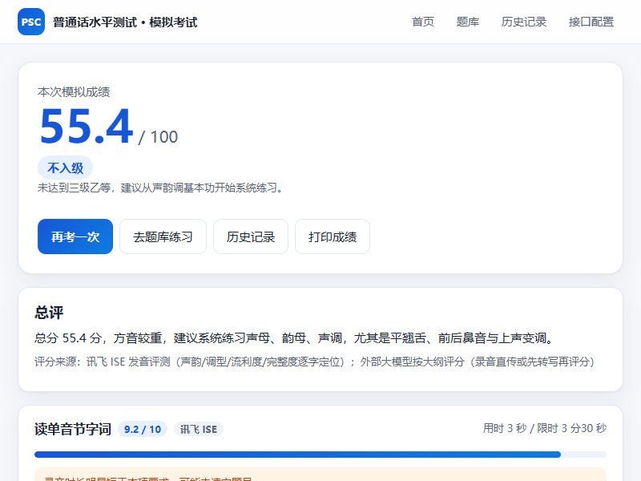
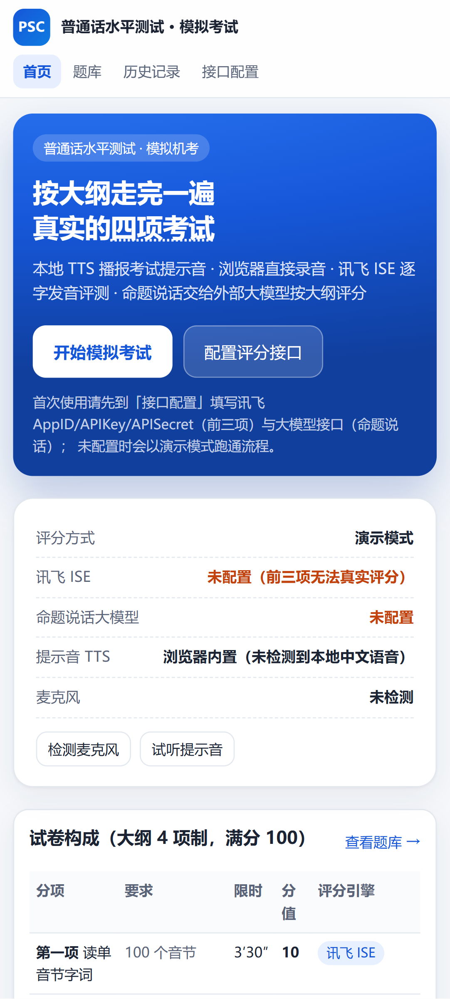

# 普通话水平测试（PSC）模拟考试

按《普通话水平测试大纲》走完四项机考流程的**本地化模拟考试系统**，同时提供 **网页版** 与 **Android APK**：本地 TTS 播报考试提示音 → 麦克风录音 → 讯飞 ISE 逐字发音评测（前三项）→ 外部大模型按大纲评分（命题说话）。

- 🌐 **在线体验（无需安装）**：<https://OLingYu.github.io/psc-exam/>
- 📱 **下载 Android APK**：<https://github.com/OLingYu/psc-exam/releases/latest>
- 纯前端（Vite + React + TypeScript），没有后端，凭据只存在本机浏览器 `localStorage`
- 麦克风录音、本地 TTS 都在设备内完成；未配置接口时自动进入**演示模式**，可以先跑通全流程

> 麦克风只能在 `https://` 或 `127.0.0.1 / localhost` 下使用。GitHub Pages 与 Android WebView 都是安全上下文，可以直接录音。

---

## 功能一览

| 分项 | 内容 | 限时 | 分值 | 评分方式 |
| --- | --- | --- | --- | --- |
| 一 | 读单音节字词 100 个 | 3′30″ | 10 | 讯飞 ISE `read_syllable` |
| 二 | 读多音节词语 100 个音节 | 2′30″ | 20 | 讯飞 ISE `read_word` |
| 三 | 朗读短文 400 音节（`∥` 前） | 4′ | 30 | 讯飞 ISE `read_chapter` |
| 四 | 命题说话（二选一，说满 3 分钟） | 3′ | 40 | 外部大模型按大纲三档评分 |

- 考前须知 → 设备调试（麦克风试音）→ 逐项作答：指导语播报 → 准备倒计时 → 录音作答（实时电平条 + 计时）→ 保存 → 下一项
- 提示音可随时打断，不会盖住录音；剩余 60/30/10 秒自动播报
- 全部完成后逐项提交评分，成绩页给出**总分、等级、各分项扣分明细、逐字定位、录音回放**
- 等级按《普通话水平测试等级标准》97/92/87/80/70/60 分档
- 题库：50 篇朗读作品、50 个命题说话题目、单音节字与多音节词语，组卷时按大纲保证声韵调覆盖、轻声儿化配额

## 截图

| 桌面端 | 手机端 |
| --- | --- |
|  |  |

## 目录结构

```
psc-exam/
├── psc-exam-web/          # 网页版（Vite + React + TypeScript）
│   ├── src/
│   │   ├── data/          # 题库：works.ts topics.ts chars.ts words.ts
│   │   ├── lib/           # 讯飞 ISE/IAT、大模型评分、TTS、录音、组卷
│   │   └── pages/         # 首页 / 考试 / 题库 / 成绩 / 历史 / 接口配置
│   ├── tools/             # mock 服务、E2E 与真机调试脚本
│   └── README.md          # 网页版详细说明（接口配置、计分口径）
├── psc-exam-Android/      # Android 版（Kotlin + WebView 打包同一套前端）
│   ├── app/src/main/      # MainActivity、TtsBridge、WebViewAssetLoader
│   ├── build_apk.ps1      # 一键：构建前端 → 同步 assets → 打包 APK
│   └── README.md          # Android 版构建与验签说明
└── docs/screenshots/      # README 用截图
```

## 本地运行

### 网页版

```bash
cd psc-exam-web
npm install
npm run dev        # 打开 http://127.0.0.1:5173
```

Windows 下也可以直接双击 `启动.bat`。生产构建：`npm run build` → 产物在 `dist/`。

### Android 版

```bat
cd psc-exam-Android
build_apk.bat
```

脚本会依次完成：前端 `npm run build` → 同步 `dist` 到 `app/src/main/assets` → `gradlew assembleRelease` → 把 APK 归档到 `out/`。

> 仓库**不包含**签名材料（`keystore.properties`、`*.jks`），因此直接 clone 构建出来的是未签名 APK；自己出包前请在本机生成 keystore 并创建 `keystore.properties`（字段见 `app/build.gradle.kts`）。

## 接口配置

页面「接口配置」里填写，凭据只保存在本机浏览器：

- **讯飞开放平台**（前三项发音评测 + 命题说话兜底转写）：AppID / APIKey / APISecret，开通「语音评测（流式版）」与「语音听写（流式版）」
- **外部大模型**（命题说话评分）：支持 OpenAI 兼容 `/chat/completions`（OpenAI、DeepSeek、智谱、Moonshot、硅基流动、Ollama、vLLM、one-api 等）与 Anthropic `/v1/messages`
- **本地 TTS**（考试提示音）：浏览器内置语音，或本机 HTTP TTS 服务（piper / edge-tts / sherpa-onnx / PaddleSpeech 等）

详细字段说明、DashScope 兼容端点注意事项、计分口径见 [`psc-exam-web/README.md`](psc-exam-web/README.md)。

## 计分口径

采用大纲「免测选择判断」的 **4 项制** 100 分（命题说话由 30 分调为 40 分），未实现选择判断项。讯飞评测分按该项满分折算，并执行大纲的超时扣分、命题说话缺时规则；扣分明细由引擎逐字定位按大纲单价权重分摊，明细合计与得分一致。

## 说明

- 本项目为个人学习与技术验证用途的模拟考试工具，**非官方产品**，成绩仅供参考，不能替代正式普通话水平测试。
- 涉及讯飞、大模型等第三方服务时，请遵守对应平台的服务条款，凭据请自行申请、不要提交到仓库。
